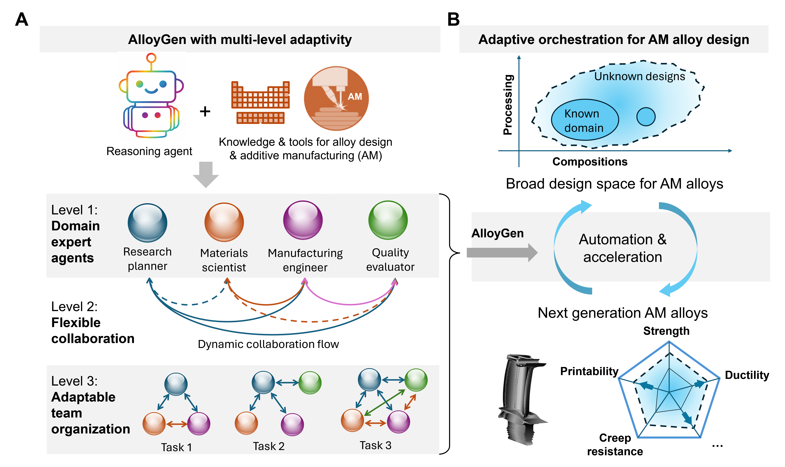

# AlloyGen: Physics-grounded self-adaptive agents for autonomous alloy-design workflows


Bo Ni<sup>1,&#42;</sup>, S. Mohadeseh Taheri-Mousavi<sup>1,2,&#42;</sup>

<sup>1</sup> Carnegie Mellon University

<sup>&#42;</sup> Corresponding authors

<sup>2</sup> Lead contact: smtaherimousavi@cmu.edu


AlloyGen is the agentic workflow component of the broader AlloyGPT package. It is a physics-grounded, self-adaptive multi-agent framework for autonomous alloy-design workflows in additive manufacturing. Additive manufacturing expands the alloy-design space by coupling composition, processing, printability, thermodynamics and performance, but practical design still requires continuous reasoning over incomplete knowledge, evolving objectives, tool selection, simulation errors and intermediate evidence.

AlloyGen addresses this missing reasoning layer by combining large-language-model agents with curated materials knowledge, executable CALPHAD thermodynamic simulations, critique and dynamic team organization. The framework demonstrates three levels of adaptivity. At the individual-agent level, a domain-expert CALPHAD agent learns specialized tool use through retrieval, execution feedback and self-correction. At the team level, role-specialized agents collaborate through dynamic interaction patterns to transform an underspecified Al-Si printability prompt into explicit criteria, executable simulations and traceable screening decisions. At the organizational level, a team-builder agent assembles task-specific expertise and tools for open-ended alloy-research tasks, demonstrated on refractory-alloy research synthesis and a multi-stage computational alloy-design investigation.

AlloyGen treats alloy design not only as a prediction or optimization problem, but as an adaptive scientific workflow that organizes knowledge, physics-based tools, simulations, critique and team structure as evidence accumulates.



## Demonstrations

Start with the recorded notebooks below. Saved results can be read without API credentials or a Thermo-Calc installation. The linked setup notes identify the code and environment associated with each demonstration.

| Manuscript section | Demonstration | Setup |
|---|---|---|
| 2.1 — Domain-expert agent | [Single-equilibrium CALPHAD problems](review_demo/Level_1_Expert_Agent/public_demo/single_equilibrium.ipynb) | [Setup and earlier versions](review_demo/Level_1_Expert_Agent/public_demo/README.md) |
| 2.1 — Domain-expert agent | [Scheil solidification problems](review_demo/Level_1_Expert_Agent/public_demo/scheil.ipynb) | [Setup and original controls](review_demo/Level_1_Expert_Agent/public_demo/README.md) |
| 2.2 — Collaborative team | [Al–Si design for AM printability](review_demo/Level_2_Collaborative_Team/Demo_3_CollaborativeTeam_Design_for_Printability.ipynb) | Original notebook setup |
| 2.3 — Dynamic team building | [Refractory-alloy research synthesis](review_demo/Level_3_Dynamical_Team_Building/Demo_4_Dynamical_Team_Building_For_Alloy_Research.ipynb) | Original notebook setup |
| 2.3 — Dynamic team building | [Multi-agent Al–Ni–Er–Zr alloy design](review_demo/Level_3_Dynamical_Team_Building/alloy_design/G54-G1-MEM-01/demo.ipynb) | [Setup and code version](review_demo/Level_3_Dynamical_Team_Building/alloy_design/G54-G1-MEM-01/README.md) |

**Supporting comparison:** [single-agent alloy design](review_demo/Level_3_Dynamical_Team_Building/alloy_design/G54-SA-EQ-01/demo.ipynb) · [setup and outcome](review_demo/Level_3_Dynamical_Team_Building/alloy_design/G54-SA-EQ-01/README.md).

The original notebooks remain at their existing paths. Revised equilibrium/Scheil demos include local preparation and execution instructions. The added alloy-design front notebooks replay saved evidence only; their archived execution notebooks and captured development source document the runs but require the original environment assumptions to be resolved before a fresh execution. These demos do not all use the same code version: follow each demo's setup notes rather than assuming the package installation below reproduces every recorded run.

## Installation

Clone the repository and create a virtual environment:

```bash
git clone https://github.com/Taheri-Mousavi-Laboratory/AlloyGen.git
cd AlloyGen
conda env create --prefix=./AlloyGen_env --file=AlloyGen_env_environment.yml
conda activate ./AlloyGen_env
pip install -e .
```

The environment file is exported from the development environment used for this work. Thermo-Calc/TC-Python functionality may require a valid local Thermo-Calc installation and license.

## Reference

Citation information will be added after publication.

## License

This repository is licensed under the [Creative Commons Attribution-NonCommercial-NoDerivatives 4.0 International License](./LICENSE).
